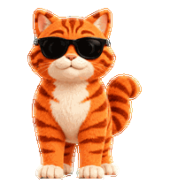

# Cool Orange Cat · 墨镜橘猫

A fluffy orange tabby wearing black sunglasses, with a white muzzle, chest, and paws. An animated companion pet package for compatible desktop clients.



## Download

Download [cool-orange-cat.zip](cool-orange-cat.zip) for a pet package containing `pet.json` and `spritesheet.png`.

For a client that accepts folder or ZIP imports, import the package and select **墨镜橘猫**. The package uses the v1 grid supported by Petdex.

## Package

```text
pet.json
spritesheet.png
```

| Property | Value |
| --- | --- |
| Sprite version | 1 |
| Image size | 1536 × 1872 pixels |
| Grid | 8 columns × 9 rows |
| Cell size | 192 × 208 pixels |
| Required animation frames | 57 |
| Background | Transparent |

Animation rows: idle, running-right, running-left, waving, jumping, failed, waiting, running (focused work), and review. Unused cells are transparent. This v1 package does not include the v2 look-direction rows.

## 中文

这是一只戴黑色墨镜的毛绒橘色虎斑猫，带有白色口鼻、胸口和爪子。下载 ZIP，在支持宠物包导入的客户端中导入并选用即可。

## Artwork

The animation artwork was generated with imagegen and assembled into a transparent sprite sheet. The sprite sheet was checked for grid dimensions, populated frames, transparent unused cells, and removable-background residue.

## License

The files in this repository, including the sprite artwork and package, are available under the [MIT License](LICENSE).
